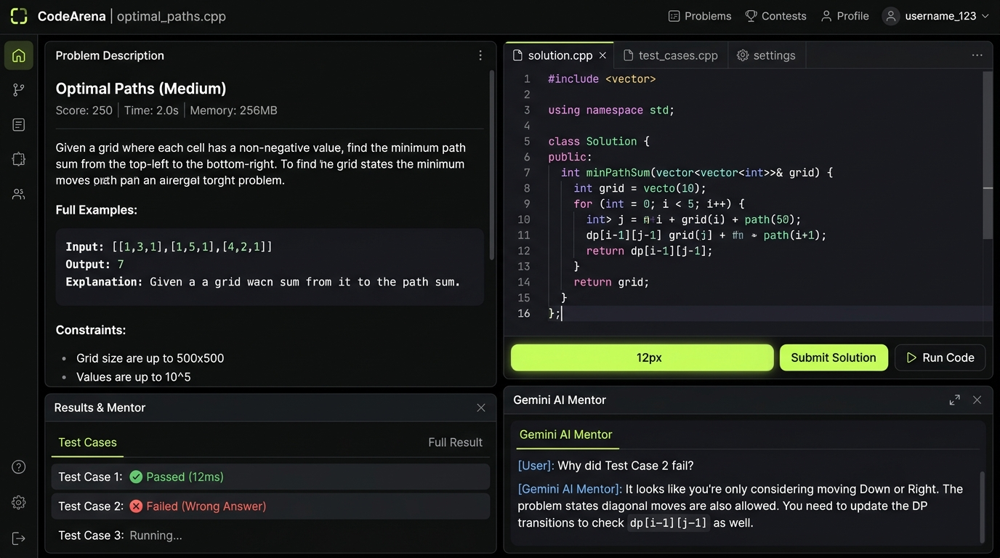
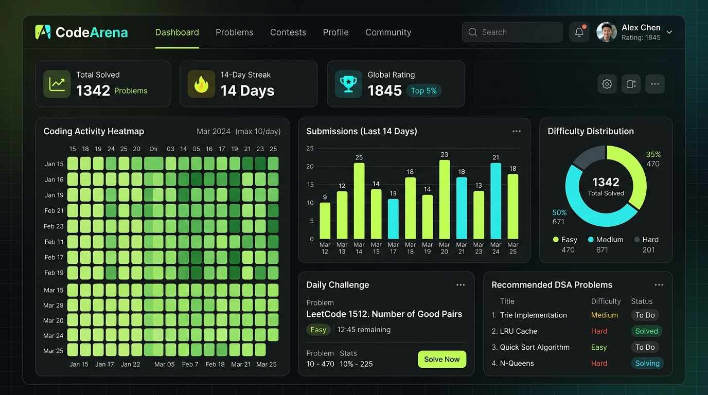

# CodeArena – AI-Powered Competitive Programming Platform

CodeArena is a modern, high-performance competitive programming and coding practice platform where developers solve algorithmic problems, write and execute code in Monaco Editor, compete in contests, track streaks, and receive intelligent mentorship from Gemini AI.

---

## 📸 Screenshots & Interface Previews

### 1. Monaco Coding Workspace & Gemini AI Mentor

*Real-time code editor with syntax highlighting, language selector (C++, Python, Java, JS), split problem description, test runner, and interactive Gemini 3.8 Flash AI mentorship.*

### 2. Interactive Analytics Dashboard & Coding Heatmap

*Comprehensive developer analytics with 70-day activity heatmap, weekly submissions chart, problem difficulty distribution, daily challenge card, and recommended DSA paths.*

---

## 1. Technology Stack

### Frontend
- **Framework:** React 19 + TypeScript
- **Styling:** Tailwind CSS v4 (Custom Dark Palette: `#0B0D0F`, `#111417`, `#151A1E`, `#B8F36B`, `#69D5C5`)
- **Code Editor:** Monaco Editor (`@monaco-editor/react`) with syntax highlighting, line numbers, custom font sizes, and dark theme
- **Visualizations:** Recharts (Weekly Activity Bar Chart, Difficulty Solving Distribution Pie Chart, 70-Day Activity Heatmap)
- **Icons:** Lucide React
- **Celebration Effects:** Canvas Confetti for accepted submissions

### Backend
- **Server:** Node.js + Express REST API (`/server/routes.ts`)
- **AI Mentorship:** Gemini API (`@google/genai` SDK with `gemini-3.8-flash`)
- **Execution Engines:**
  - **Judge0 CE API:** Multi-language remote compilation and sandboxed execution for C++, Python, Java, and JavaScript.
  - **Node.js Sandbox:** Isolated `node:vm` sandbox for instant, zero-credential JavaScript test execution.
- **Data Persistence:** Server-side isolated database store in `/data/arena_db.json` with user isolation, problem seeds, submissions history, contests, and streaks.

---

## 2. Core Features

1. **Interactive Dashboard:**
   - Personalized greeting, daily motivation quotes, and instant Daily Challenge launcher.
   - Comprehensive metrics: Total solved, Easy / Medium / Hard counters, active streaks, and total submissions.
   - Visualizations: 70-day activity heatmap, weekly coding activity bar chart, problem difficulty distribution donut chart.
   - Smart problem recommendations tailored to user's experience level.

2. **Problem Explorer:**
   - 20 seeded, distinct algorithmic problems spanning Arrays, Strings, Binary Search, Sorting, Linked Lists, Stacks, Queues, Trees, Graphs, Dynamic Programming, Greedy Algorithms, Backtracking, and Hashing.
   - Real-time search by title, ID, or topic keywords.
   - Multi-criteria filtering by difficulty, topic tags, solved/unsolved status, and bookmarks.

3. **Monaco Coding Workspace:**
   - Professional code editor supporting C++, Python, Java, and JavaScript with language-specific starter templates.
   - Resizable editor and problem description panels.
   - Customizable font size and dark editor theme.
   - Code draft persistence per problem and language in local storage.
   - Tabbed execution dock: Test Cases, Output (stdout, runtime ms, memory), Submission Results (verdict, test case diffs, runtime percentiles), and AI Assistant.

4. **Gemini AI Coding Mentor:**
   - **Explain Problem:** Simple, intuitive breakdown with real-world analogies and edge cases.
   - **Progressive Hints:** Multi-tier hints (Levels 1, 2, 3) without spoiling complete solution code.
   - **Debug Assistant:** Analyzes user code against failed test cases or compilation errors.
   - **Complexity Analysis:** Deep Big-O Time and Space complexity evaluation.
   - **Concept Explanation:** Explains underlying data structure patterns and mnemonics.
   - **Solution Explanation:** Step-by-step optimal walkthrough with clean implementation.
   - **Follow-up Chat:** Interactive Q&A in the context of the current problem and code.

5. **Contests & Tournaments:**
   - Active, upcoming, and completed competitive programming contests.
   - Live timers, problem lists, participant counts, and real-time contest leaderboards.

6. **Global Leaderboard:**
   - Weekly, Monthly, and All-Time global rankings.
   - Podium celebration for Top 3 champions.
   - Automatic highlighting for current logged-in user.

7. **User Profile & Bookmarks:**
   - Detailed user statistics, success rate, experience level, and favorite languages.
   - Profile editor for username, avatar URL, and bio.
   - Personal saved problem bookmarks list.
   - Complete submission history with full code viewer modal.

---

## 3. Environment Variables

Create a `.env` file in the root directory:

```env
# Gemini API Key (Required for AI Mentor)
# AI Studio automatically injects this from user secrets
GEMINI_API_KEY="YOUR_GEMINI_API_KEY"

# Application URL
APP_URL="http://localhost:3000"

# Judge0 API Key (Optional for C++, Python, Java remote compilation)
# Obtain a free key from RapidAPI: https://rapidapi.com/hermanzdosilovic/api/judge0-ce
JUDGE0_API_KEY=""

# Judge0 Host (Default is RapidAPI's Judge0 CE host)
JUDGE0_API_HOST="judge0-ce.p.rapidapi.com"
```

---

## 4. Execution Engine Setup

CodeArena implements a dual-engine architecture:

1. **Built-in Node.js Sandbox (JavaScript):**
   - Works out-of-the-box with **zero API keys required**.
   - Runs in an isolated `node:vm` context with timeouts and stdout capture.
   - Returns real test results, runtimes, and memory statistics.

2. **Judge0 API (C++, Python, Java, JavaScript):**
   - If `JUDGE0_API_KEY` is provided, CodeArena proxies execution requests to the remote Judge0 sandbox.
   - If `JUDGE0_API_KEY` is not provided, the workspace clearly indicates `Unconfigured` status for C++/Python/Java, while guiding the user to test JavaScript or configure their key in Settings.

---

## 5. Development and Deployment

### Install Dependencies
```bash
npm install
```

### Run Development Server
```bash
npm run dev
```
The application will start on port 3000 with Vite and integrated Express API middleware.

### Build and Start for Production
```bash
npm run build
npm start
```
Runs `tsx server.ts` which serves static assets and production API routes on port 3000.
